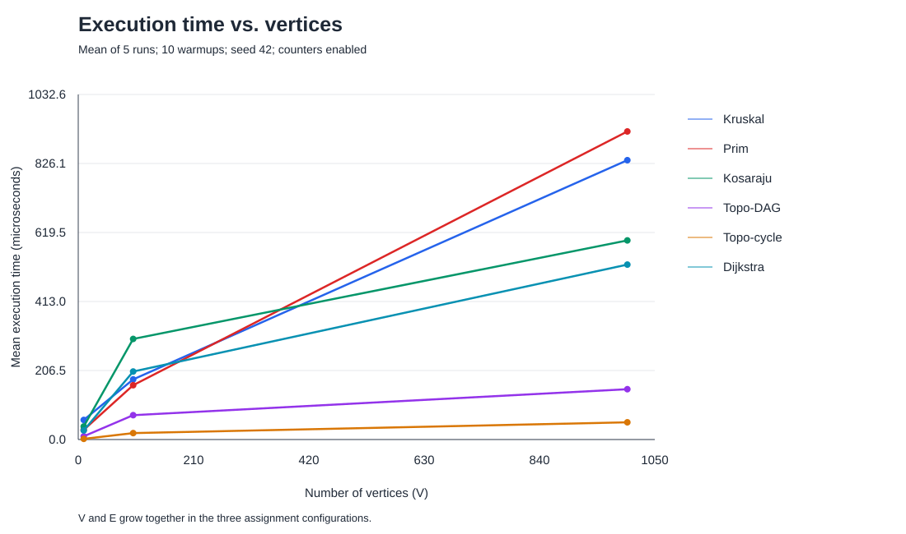
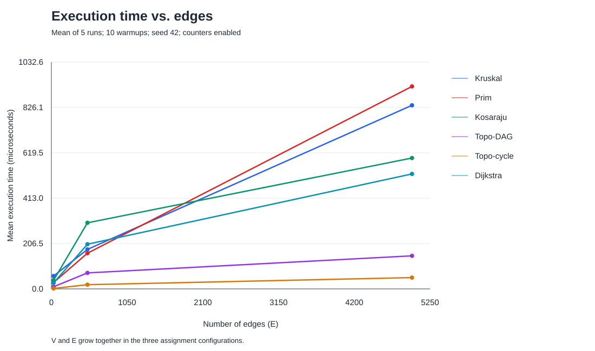

# Assignment 3: Smart City Infrastructure and Route Planning

## Overview

This Java application represents a city's districts as graph vertices and roads as weighted edges. It supports minimum-cost infrastructure planning, directed connectivity analysis, dependency ordering, and shortest-route planning. The application runs in the console; it does not require a GUI, external libraries, Maven, or Gradle.

An MST minimizes the cost of connecting all districts. Dijkstra minimizes the distance from a selected source to each district. These are different optimization problems.

### Requirements and commands

Install JDK 17 or newer. Both `java` and `javac` must be available in the terminal. Open this project folder in VS Code and use its integrated terminal. Run commands from the project root:

```sh
sh run.sh demo
sh run.sh test
sh run.sh benchmark
sh run.sh all
```

The script compiles all source and test files before running the selected command. `demo` is the default. `all` runs tests, the demonstration, and benchmarks. Benchmarks regenerate CSV files, SVG plots, and results/tables/results.md. This README is edited manually. After rerunning benchmarks, update its Results and Comparison sections using the new data. Actual timings vary between runs.

In VS Code, `Main.java` can also be run with Run Java. Tests are in `GraphTest.java`; benchmarks are in `Benchmark.java`. For benchmark output paths to be correct, the working directory must be the project root.

Manual compilation on macOS/Linux:

```sh
mkdir -p bin
find src tests -name '*.java' -print > bin/sources.txt
javac --release 17 -encoding UTF-8 -d bin @bin/sources.txt
java -cp bin Main
java -cp bin GraphTest
java -cp bin experiments.Benchmark
```

### Project structure

```text
src/
  Main.java
  graph/Edge.java, Graph.java
  dsu/DSU.java
  mst/Kruskal.java, Prim.java, MSTResult.java
  coonect/Kosaraju.java, TopoSort.java
  shortestpath/Dijkstra.java
  experiments/GraphGeneration.java, Metrics.java, Benchmark.java, PlotWriter.java
tests/GraphTest.java
results/tables/
results/plots/
DEFENSE_RU.md
run.sh
README.md
```

The existing package name `coonect` is retained consistently in both paths and imports.

## Implementation

### Graph representation

`Edge` contains immutable integer fields `from`, `to`, and `weight`. `Graph` contains a vertex count, a directed flag, a global edge list, and adjacency lists. Vertex identifiers range from 0 to V-1. Graphs must contain at least one vertex. Invalid identifiers are rejected with `IllegalArgumentException`.

A directed edge is added to its source's adjacency list. An undirected edge is stored once globally and twice in adjacency lists, one orientation at each endpoint. Read-only views prevent callers from modifying internal lists directly; the graph must not be modified while an algorithm runs. Retrieving a view does not copy the entire list. Parallel edges and self-loops are supported by the model, although experimental generators exclude both.

Weights are `int`; accumulated MST costs and shortest distances are `long` to avoid integer sum overflow. Negative weights are allowed by the graph and MST algorithms, but rejected by Dijkstra. Algorithms do not mutate the input graph.

### DSU

`parent` stores links toward each group's representative. `size` is meaningful at representatives and stores group size. Initially `parent[i] = i` and `size[i] = 1`. `find` uses two iterative passes: locate the representative, then compress the path. `union` finds both representatives, returns false if they are equal, and otherwise attaches the smaller group to the larger group. Iteration avoids recursive stack growth. DSU can be given a `Metrics` object to count work.

### Minimum spanning tree

Kruskal copies and sorts all edges by weight, then uses DSU to accept edges that connect different components. It stops when V-1 edges have been selected, or when all edges are exhausted.

Prim uses a binary heap (`PriorityQueue<Edge>`) of candidate edges and a visited array. It discards edges whose destination is already visited. This is a lazy edge-based implementation: the heap may contain O(E) edges. It restarts from each unvisited component if the graph is disconnected.

Both return an `MSTResult` containing selected edges, a total weight, and a connectivity flag. For disconnected input, the flag is false and the returned result is a minimum spanning forest; it is explicitly not reported as a city-wide MST. A singleton graph has a valid empty MST of weight zero. Directed input is rejected. Equal edge weights can produce different valid MSTs with the same total cost.

### Topological ordering

`TopoSort` implements Kahn's algorithm using indegree counts and an `ArrayDeque`. It repeatedly removes a zero-indegree vertex and updates its outgoing neighbors. If fewer than V vertices are removed, a directed cycle exists. The result contains an immutable order and `hasCycle`. For a cyclic graph, any returned partial order is not a valid complete topological ordering. Only directed graphs are accepted.

### Strongly connected components

`Kosaraju` first computes DFS finishing order, builds a graph with all edges reversed, and then traverses the reversed graph in decreasing finishing order. Each traversal forms one SCC. Both traversals use explicit stacks, including DFS frames for finishing order, so long paths do not cause recursive stack overflow. Singleton components are included. Only directed graphs are accepted.

### Shortest paths

Dijkstra validates that every edge has non-negative weight. It maintains `long[] distances`, `int[] previous`, and a binary heap of `(vertex, distance)` records. On a successful relaxation it inserts a new record; stale records are skipped when removed. `pathTo` follows predecessor links and reverses the result. Unreachable vertices have distance `Long.MAX_VALUE` and an empty path. The source has distance zero and a one-vertex path.

Non-negative weights ensure that the currently smallest tentative distance cannot later be improved through an unsettled vertex with a negative edge. Negative edges break that guarantee. For example, edges 0->1 of weight 2, 0->2 of weight 5, and 2->1 of weight -10 allow a later path to improve vertex 1 after a conventional greedy settlement. This implementation deliberately rejects negative weights; Bellman-Ford would be appropriate when negative edges must be supported, with negative-cycle handling.

## Complexity Analysis

V is the number of vertices and E is the number of logical edges. For an undirected graph there are 2E adjacency entries, which does not change asymptotic complexity. Bounds below include returned result structures but exclude the original graph unless stated.

| Operation / algorithm | Time | Additional space |
|---|---|---|
| Graph storage | O(V + E) construction work for V vertices and E insertions, amortized | O(V + E) total graph storage |
| DSU initialization | O(V) | O(V) |
| DSU find / union | O(alpha(V)) amortized per operation over a sequence, after initialization | O(1) per operation with existing arrays |
| Kruskal | O(V + E log(E + 1) + E alpha(V)) | O(V + E) |
| Prim, lazy edge heap | O(V + E log(E + 1)) | O(V + E) |
| Kosaraju | O(V + E) | O(V + E), including reversed graph |
| Topological ordering | O(V + E) | O(V) |
| Dijkstra, lazy record heap | O(V + E + E log(E + 1)) | O(V + E) |
| Reconstruct one shortest path | O(V) worst case | O(V) |

For connected graphs, Kruskal is commonly summarized as O(E log E). It must sort the entire edge list even if DSU accepts V-1 edges early. Prim performs heap operations as it discovers candidate roads. Larger E increases sorting and heap work. Larger V increases arrays and traversal work.

In simple graphs E <= V(V-1) (or half that for undirected graphs), so log E = O(log V). Thus lazy Prim can also be expressed as O(V + E log V), and Dijkstra as O((V + E) log V) for V >= 2. The O(E)-sized heaps in this code must still be included in space analysis. The more precise E-based forms above also account for parallel edges supported by the graph model. For E=0, the bounds retain O(V).

Union by size alone bounds tree depth by O(log V), because a node's depth increases only when its group joins a group at least as large. Path compression shortcuts repeated searches. Together they give inverse-Ackermann amortized cost alpha(V), which is extremely small for practical input sizes. A single operation need not take constant time, and DSU initialization still takes O(V).

Kosaraju and topological sorting scan vertices and edges a constant number of times. Doubling V and E therefore roughly doubles theoretical work. Runtime does not have to double exactly due to JVM compilation, allocation, garbage collection, CPU scheduling, and small sample sizes.

## Experimental Setup

| Configuration | V | E |
|---|---:|---:|
| Small | 10 | 30 |
| Medium | 100 | 500 |
| Large | 1000 | 5000 |

Each graph is generated with a fresh `Random(42)`. Weights are integers from 1 through 100, inclusive. No generator creates parallel edges or self-loops. Graph generation is deterministic, including weights and insertion order.

- **Connected undirected:** for each vertex v > 0, add an edge to a random earlier vertex. These V-1 roads form a spanning tree. Add unique random roads until exactly E edges exist. Kruskal, Prim, and Dijkstra use the same graph at each size; Dijkstra's source is 0.
- **DAG:** generate unique directed edges only from a smaller vertex identifier to a larger one. Directed cycles are impossible. These graphs are used for topological sorting.
- **Cyclic directed:** let the first max(2, floor(V/2)) vertices form a directed ring. Add a forward chain through the remaining vertices. Extra edges may go forward globally or in either direction inside the ring's core, but never backward from later vertices into the core. This guarantees a cycle and a known non-trivial SCC plus singleton SCCs. These graphs are used for SCC and cyclic topological checks. A zero-indegree queue is empty immediately in this particular cyclic model, so the cyclic topological result needs the initial indegree scan but no vertex removals.

For each of six algorithm/input combinations and three sizes, run ten untimed warmups and five measured runs. This yields 90 measured runs. Every execution creates fresh algorithm state and a fresh `Metrics` object. `System.nanoTime()` measures elapsed algorithm time. The graph is reused but never mutated. Generation, console printing, CSV writing, and plot generation occur outside timing. Kruskal's copy/sort and Kosaraju's reversed graph are inside timing. Small MST result validations are also inside timed experiment calls. Results are consumed through a volatile sink after timing.

These are instrumented educational benchmarks, not JMH measurements. Counters are enabled during timing. There are no separate JVM forks, so warmup and execution order can affect timings. Five repetitions satisfy the assignment but do not establish statistical significance. Exact durations are not reproducible; graph contents and operation counts are reproducible. Environment information is saved in [environment.txt](results/tables/environment.txt).

### Operation definitions

| Counter | Definition |
|---|---|
| Edge examinations | An edge processed in an explicit algorithm loop; includes Dijkstra's negative-weight validation, topological indegree construction, and Kosaraju's reverse-edge construction |
| Comparisons | Calls to the weight/distance comparator used by sorting or a priority queue; excludes ordinary if conditions |
| Find calls | Public DSU `find` invocations; the iterative implementation does not recursively increase this count |
| Union calls | DSU `union` invocations, including unsuccessful unions |
| Parent traversals | Parent links followed during both root search and path compression passes |
| Queue adds / polls | Explicit insertions / removals in Prim, Kahn, or Dijkstra; DFS stack work is not counted here |
| Relaxations | Successful decreases of tentative distances in Dijkstra |
| Vertex visits | Prim visits, Kahn removals, non-stale Dijkstra removals, or visits in each of the two Kosaraju passes |

Counters represent distinct activities, not interchangeable units of CPU work. Do not compare sums of unrelated counters as though they were identical operations. Counts are checked to match across the five repeats of each input.

## Results

Times are means of five measured runs after ten warmups. Counters are per run.

| Algorithm | V | E | Mean (microseconds) | Edge examinations | Comparisons | Find calls | Union calls | Parent traversals | Queue adds | Queue polls | Relaxations | Vertex visits |
|---|---:|---:|---:|---:|---:|---:|---:|---:|---:|---:|---:|---:|
| Kruskal | 10 | 30 | 58.625 | 14 | 107 | 28 | 14 | 30 | 0 | 0 | 0 | 0 |
| Prim | 10 | 30 | 28.975 | 60 | 203 | 0 | 0 | 0 | 30 | 30 | 0 | 10 |
| Kosaraju | 10 | 30 | 39.117 | 90 | 0 | 0 | 0 | 0 | 0 | 0 | 0 | 20 |
| Topo-DAG | 10 | 30 | 9.675 | 60 | 0 | 0 | 0 | 0 | 10 | 10 | 0 | 10 |
| Topo-cycle | 10 | 30 | 2.050 | 30 | 0 | 0 | 0 | 0 | 0 | 0 | 0 | 0 |
| Dijkstra | 10 | 30 | 27.150 | 90 | 82 | 0 | 0 | 0 | 18 | 18 | 17 | 10 |
| Kruskal | 100 | 500 | 179.967 | 164 | 3827 | 328 | 164 | 496 | 0 | 0 | 0 | 0 |
| Prim | 100 | 500 | 162.592 | 1000 | 7697 | 0 | 0 | 0 | 500 | 500 | 0 | 100 |
| Kosaraju | 100 | 500 | 301.017 | 1500 | 0 | 0 | 0 | 0 | 0 | 0 | 0 | 200 |
| Topo-DAG | 100 | 500 | 72.883 | 1000 | 0 | 0 | 0 | 0 | 100 | 100 | 0 | 100 |
| Topo-cycle | 100 | 500 | 19.242 | 500 | 0 | 0 | 0 | 0 | 0 | 0 | 0 | 0 |
| Dijkstra | 100 | 500 | 203.508 | 1500 | 2403 | 0 | 0 | 0 | 200 | 200 | 199 | 100 |
| Kruskal | 1000 | 5000 | 835.942 | 3356 | 50369 | 6712 | 3356 | 12356 | 0 | 0 | 0 | 0 |
| Prim | 1000 | 5000 | 921.942 | 10000 | 110958 | 0 | 0 | 0 | 5000 | 5000 | 0 | 1000 |
| Kosaraju | 1000 | 5000 | 595.867 | 15000 | 0 | 0 | 0 | 0 | 0 | 0 | 0 | 2000 |
| Topo-DAG | 1000 | 5000 | 150.625 | 10000 | 0 | 0 | 0 | 0 | 1000 | 1000 | 0 | 1000 |
| Topo-cycle | 1000 | 5000 | 51.525 | 5000 | 0 | 0 | 0 | 0 | 0 | 0 | 0 | 0 |
| Dijkstra | 1000 | 5000 | 523.483 | 15000 | 36698 | 0 | 0 | 0 | 1987 | 1987 | 1986 | 1000 |

The detailed data is in [raw.csv](results/tables/raw.csv) and [summary.csv](results/tables/summary.csv). Zero counters mean that type of operation was not recorded for the algorithm, not that no work was performed.





Both plots use the same three configurations, so V and E change together. They do not isolate the causal effect of one variable. All algorithms are shown on linear axes; very short runtimes appear near the baseline.

## Comparison and Discussion

- At V=10, Kruskal averaged 58.625 microseconds and Prim 28.975 microseconds; Prim was faster in this run. Kruskal recorded 107 sort comparisons and 14 union calls; Prim recorded 203 heap comparisons and 30 queue polls.
- At V=100, Kruskal averaged 179.967 microseconds and Prim 162.592 microseconds; Prim was faster in this run. Kruskal recorded 3827 sort comparisons and 164 union calls; Prim recorded 7697 heap comparisons and 500 queue polls.
- At V=1000, Kruskal averaged 835.942 microseconds and Prim 921.942 microseconds; Kruskal was faster in this run. Kruskal recorded 50369 sort comparisons and 3356 union calls; Prim recorded 110958 heap comparisons and 5000 queue polls.

Kruskal sorts all E edges but can stop its DSU scan early. Prim avoids global sorting but maintains and drains a lazy heap, including obsolete candidate edges. Comparator counts are not the entire cost: allocations, list copies, DSU work, and heap maintenance also matter. A winner on these inputs is not a universal winner. DSU path compression and union by size keep root searches short; the traversal counter records actual link-following work, but no unoptimized DSU timing experiment is claimed.

Kosaraju averaged 39.117 microseconds for the small input and 595.867 for the large input. Its edge examinations are exactly 3E (first traversal, transpose construction, second traversal) and vertex visits are exactly 2V. These counts agree with O(V+E), even when elapsed-time ratios differ because of JVM and allocation effects.

Topological sorting on the DAG examines 2E edges and removes all V vertices. On the cyclic input it examines E edges for indegrees, but removes no vertices because the ring and forward chain give every vertex positive indegree. Its smaller measured cost is a property of this input, not a faster asymptotic bound for all cyclic graphs.

Dijkstra averaged 27.150 microseconds on the small graph and 523.483 on the large graph. It examines E edges to validate weights plus 2E adjacency entries because every vertex in the connected undirected graph is reachable. Successful relaxations and stale heap records depend on the weights and graph topology, explaining changes in heap comparisons and polls.

The fixed seed makes the inputs and operation counts reproducible, not wall-clock durations. Five measured runs, ten warmups, shared-JVM execution, and counters enabled during timing limit statistical conclusions. Use raw runs to inspect variability. No exact proportional growth or statistically significant speed difference is claimed.

## Testing

Run `sh run.sh test`. Tests use explicit checks that throw `AssertionError`, so the `-ea` JVM flag is not needed. The suite contains deterministic cases and 30 fixed-seed random small-graph trials; the printed number counts individual assertions, not separate test cases.

Required scenarios are covered: small graphs, disconnected graphs, cycles, multiple valid MSTs, unreachable vertices, duplicate weights, and a single vertex. Additional tests cover directed/undirected edge storage, read-only views, invalid vertices, negative MST weights, parallel edges, self-loops, zero-weight roads, negative-weight rejection by Dijkstra, stale heap records, and sums larger than Integer.MAX_VALUE.

Correctness is checked independently where possible:

- MST examples have known costs. For random graphs, all subsets of edges are enumerated on graphs of at most five vertices, using label merging independent of DSU, to find the minimum spanning forest cost. Selected edges are checked for acyclicity and spanning of input components. Kruskal and Prim are also compared on all generated experiment sizes.
- Topological results must contain each vertex exactly once and place every edge's source before its destination. Known cycles and self-loops must be detected.
- SCC membership is compared with independent all-pairs reachability: two vertices share an SCC exactly when they can reach each other. Every vertex must occur exactly once. The cyclic generator also has a known expected SCC count at all three sizes.
- Dijkstra's distances on random graphs, from every source, are compared with Floyd-Warshall. Reconstructed paths must use existing edges, have correct endpoints, and sum to the reported shortest distance. Unreachable paths must be empty.
- DSU tests cover repeated unions, joining differently sized groups, invalid identifiers, transitive membership, and reduced parent-link traversal after path compression.
- Generators are checked for exact edge counts, fixed-seed reproducibility, no duplicate edges/self-loops, connectivity, DAG validity, and guaranteed cycles.

The latest verified run completed **32,599 assertions** without failure. This count can change if tests are extended.

## Conclusion

Use an MST when infrastructure must connect all districts at minimum total construction cost. Kruskal is natural when a global edge list is available and DSU is already implemented. Prim is natural when exploring a network through adjacency lists. Their optimal costs agree, but actual performance depends on input structure and implementation.

Use topological ordering for dependencies only when the directed graph is acyclic. Use SCC analysis to group locations that are mutually reachable, including in graphs with cycles. Use Dijkstra for shortest routes from one source when weights are non-negative; an MST does not generally preserve shortest paths.

The measured data supports discussing implementation costs, while complexity describes growth in the limit. JVM noise and only three coupled V/E configurations prevent strong universal speed claims. All experiments can be regenerated with one command.
